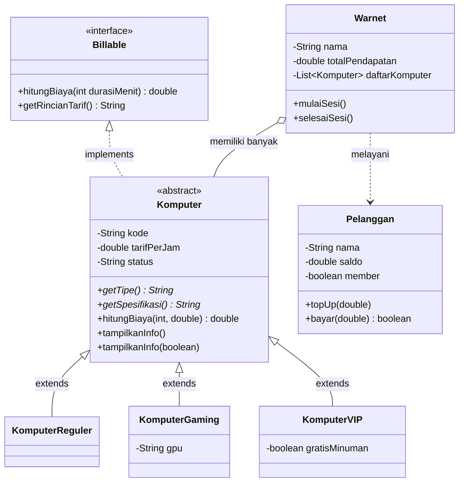

# Sistem Manajemen Warnet "Net-Zone"

**Praktik Lab Session 3B: Pengembangan Program Berbasis Object-Oriented Programming (OOP)**
Bahasa pemrograman: **Java** | IDE: **Apache NetBeans** | Package: `LabSession`

| | |
|---|---|
| Nama | Fizillal Kamal Arsad Purwanto |
| NIM | L0325046 |
| Program Studi | Informatika, PSDKU Kebumen, Universitas Sebelas Maret |

---

## Daftar Isi

1. [Deskripsi Program](#1-deskripsi-program)
2. [Ketentuan Tugas dan Pemenuhannya](#2-ketentuan-tugas-dan-pemenuhannya)
3. [Struktur Project](#3-struktur-project)
4. [Diagram Hubungan Class](#4-diagram-hubungan-class)
5. [Aturan Tarif (Studi Kasus)](#5-aturan-tarif-studi-kasus)
6. [Penjelasan Kode per File](#6-penjelasan-kode-per-file)
7. [Pemetaan Konsep OOP ke Kode](#7-pemetaan-konsep-oop-ke-kode)
8. [Alur Program (Main)](#8-alur-program-main)
9. [Contoh Output dan Penjelasannya](#9-contoh-output-dan-penjelasannya)
10. [Cara Menjalankan Program](#10-cara-menjalankan-program)
11. [Cara Mengubah Data](#11-cara-mengubah-data)
12. [Masalah yang Sering Muncul](#12-masalah-yang-sering-muncul)
13. [Kesimpulan](#13-kesimpulan)

---

## 1. Deskripsi Program

Program ini mensimulasikan **pengelolaan sebuah warnet (warung internet)** bernama *Net-Zone*. Warnet memiliki beberapa jenis komputer dengan tarif dan aturan penagihan yang berbeda. Pelanggan dapat melakukan top up saldo, memulai sesi pemakaian komputer, lalu mengakhiri sesi dan membayar tagihan dari saldonya.

Program menyelesaikan permasalahan sederhana berikut:

- mencatat daftar komputer beserta tarif, spesifikasi, dan statusnya (tersedia, dipakai, perbaikan);
- menghitung biaya pemakaian sesuai jenis komputer dan durasi;
- memberikan diskon khusus untuk pelanggan member;
- memproses pembayaran dari saldo dan menolaknya jika saldo tidak cukup;
- menghitung total pendapatan warnet.

Tema ini dipilih karena hubungan antarkomponennya logis untuk OOP: semua komputer adalah "komputer" yang sama jenisnya (superclass), tetapi cara menghitung biayanya berbeda-beda (subclass), dan semuanya bisa ditagih (interface).

---

## 2. Ketentuan Tugas dan Pemenuhannya

### Ketentuan wajib

| Ketentuan | Implementasi | Lokasi |
|---|---|---|
| **Encapsulation**: atribut `private`, getter/setter, perubahan lewat method | Atribut `kode`, `tarifPerJam`, `status`, `saldo`, `nama`, dan lainnya bersifat `private`. Setter memvalidasi data. Saldo hanya berubah lewat `topUp()` dan `bayar()` | `Komputer`, `KomputerGaming`, `KomputerVIP`, `Pelanggan`, `Warnet` |
| **Inheritance**: minimal 1 superclass dan 2 subclass, `extends`, constructor dan `super()` | Superclass `Komputer`; subclass `KomputerReguler`, `KomputerGaming`, `KomputerVIP`. Ketiganya memakai `extends Komputer` dan memanggil `super(kode, tarif)` | `Komputer`, `KomputerReguler`, `KomputerGaming`, `KomputerVIP` |
| **Polymorphism**: overriding `@Override`, overloading, runtime polymorphism | Overriding pada `getTipe()`, `getSpesifikasi()`, `hitungBiaya()`, `getRincianTarif()`, `toString()`. Overloading pada `hitungBiaya(int)` / `hitungBiaya(int, double)` dan `tampilkanInfo()` / `tampilkanInfo(boolean)`. Runtime polymorphism lewat `List<Komputer>` yang berisi objek subclass | `Komputer`, subclass, `Warnet`, `Main` |
| **Abstract class**: minimal 1 abstract class dan 1 abstract method, subclass mengimplementasikan | `Komputer` adalah abstract class dengan abstract method `getTipe()` dan `getSpesifikasi()`, diimplementasikan oleh semua subclass | `Komputer` dan subclass |
| **Interface**: minimal 1 interface, `implements`, memenuhi kontrak | Interface `Billable` diimplementasikan oleh `Komputer` (`implements Billable`). Semua subclass memenuhi kontraknya | `Billable`, `Komputer` |

### Ketentuan tambahan

| Ketentuan | Pemenuhan |
|---|---|
| Minimal 4 class termasuk `Main` | Ada **8 file**: 1 interface, 1 abstract class, 3 subclass, 2 class pendukung (`Pelanggan`, `Warnet`), dan `Main` |
| Minimal 4 objek | Ada **7 objek utama**: 3 komputer (`pc1`, `pc2`, `pc3`), 3 pelanggan (`budi`, `sari`, `andi`), dan 1 warnet |
| Dapat dijalankan dan menghasilkan output sesuai studi kasus | Program berjalan dengan `BUILD SUCCESS` dan menampilkan simulasi lengkap (lihat bagian 9) |
| Hubungan logis antara superclass, subclass, dan interface | `Komputer` (jenis perangkat) > tiga jenis komputer spesifik; `Billable` adalah kontrak penagihan yang berlaku untuk semuanya |

---

## 3. Struktur Project

```
ManajemenWarnet
└── Source Packages
    └── LabSession
        ├── Billable.java          (interface)
        ├── Komputer.java          (abstract class / superclass)
        ├── KomputerReguler.java   (subclass 1)
        ├── KomputerGaming.java    (subclass 2)
        ├── KomputerVIP.java       (subclass 3)
        ├── Pelanggan.java         (class pendukung)
        ├── Warnet.java            (class pengelola)
        └── Main.java              (titik awal program)
```

Setiap file diawali dengan baris `package LabSession;`.

---

## 4. Diagram Hubungan Class



Keterangan: tanda `<<interface>>` dan `<<abstract>>` menunjukkan jenis class; huruf miring atau tanda `*` menunjukkan abstract method; panah putus-putus dengan segitiga menunjukkan `implements`, panah dengan segitiga penuh menunjukkan `extends`.

---

## 5. Aturan Tarif (Studi Kasus)

| Jenis | Tarif per jam | Aturan khusus |
|---|---|---|
| Reguler | Rp5.000 | Dihitung proporsional per menit |
| Gaming | Rp8.000 | Pemakaian **minimal dihitung 30 menit** |
| VIP | Rp12.000 | **Diskon paket 10%** jika durasi 180 menit atau lebih |

Aturan tambahan: pelanggan **member mendapat diskon 10%** dari total tagihan (diterapkan setelah aturan jenis komputer).

Rumus dasar: `biaya = tarifPerJam × durasiMenit ÷ 60`

---

## 6. Penjelasan Kode per File

> Potongan kode di bawah disingkat agar fokus pada bagian penting. Kode lengkap ada di masing-masing file `.java`.

### 6.1 `Billable.java` (Interface)

```java
public interface Billable {
    double hitungBiaya(int durasiMenit);
    String getRincianTarif();
}
```

**Penjelasan:**
- `interface` adalah **kontrak**: hanya berisi tanda tangan method tanpa isi.
- Siapa pun yang `implements Billable` wajib menyediakan dua method ini: `hitungBiaya(int)` untuk menghitung tagihan, dan `getRincianTarif()` untuk teks ringkasan tarif.
- Dengan interface ini, objek apa pun yang bisa ditagih (sekarang komputer, nanti bisa saja printer atau ruang meeting) punya cara pakai yang seragam.

---

### 6.2 `Komputer.java` (Abstract Class dan Superclass)

```java
public abstract class Komputer implements Billable {

    public static final String TERSEDIA = "TERSEDIA";
    public static final String DIPAKAI = "DIPAKAI";
    public static final String PERBAIKAN = "PERBAIKAN";

    private String kode;
    private double tarifPerJam;
    private String status;

    public Komputer(String kode, double tarifPerJam) {
        this.kode = kode;
        setTarifPerJam(tarifPerJam);
        this.status = TERSEDIA;
    }
    ...
}
```

**Penjelasan bagian demi bagian:**

| Bagian | Fungsi |
|---|---|
| `abstract class` | Class ini **tidak bisa langsung dibuat objeknya** (`new Komputer(...)` akan error). Ia hanya menjadi dasar bagi subclass |
| `implements Billable` | Class ini terikat kontrak `Billable`. Karena `Komputer` abstract, method `hitungBiaya(int)` boleh dibiarkan belum diisi dan diwajibkan pada subclass |
| Konstanta `TERSEDIA`, `DIPAKAI`, `PERBAIKAN` | Nilai status yang valid. Memakai konstanta mencegah salah ketik string |
| Atribut `private` | Contoh **encapsulation**: data tidak bisa diakses langsung dari luar class |
| Constructor | Mengisi `kode`, memanggil `setTarifPerJam()` agar tarif divalidasi sejak awal, dan menetapkan status awal `TERSEDIA` |

**Getter dan setter dengan validasi:**

```java
public void setTarifPerJam(double tarifPerJam) {
    if (tarifPerJam <= 0) {
        throw new IllegalArgumentException("Tarif per jam harus lebih dari 0");
    }
    this.tarifPerJam = tarifPerJam;
}

public void setStatus(String status) {
    if (!status.equals(TERSEDIA) && !status.equals(DIPAKAI) && !status.equals(PERBAIKAN)) {
        throw new IllegalArgumentException("Status tidak valid: " + status);
    }
    this.status = status;
}
```

Setter menolak data yang tidak masuk akal (tarif nol atau negatif, status asal-asalan). Inilah manfaat nyata encapsulation: data selalu terjaga valid.

**Abstract method:**

```java
public abstract String getTipe();
public abstract String getSpesifikasi();
```

Method tanpa isi. Setiap subclass **wajib** mengisinya dengan versinya sendiri.

**Method pembantu:**

```java
protected void validasiDurasi(int durasiMenit) { ... }
public static String rupiah(double nilai) { ... }
```

- `validasiDurasi` bersifat `protected`, jadi hanya bisa dipakai oleh class turunan. Ia menolak durasi nol atau negatif.
- `rupiah` adalah method `static` yang memformat angka menjadi `Rp5.000` memakai locale Indonesia (`id-ID`), sehingga pemisah ribuan berupa titik.

**Overriding dari interface dan Object:**

```java
@Override
public String getRincianTarif() {
    return getTipe() + " - " + rupiah(tarifPerJam) + "/jam";
}

@Override
public String toString() {
    return getTipe() + " " + kode;
}
```

- `getRincianTarif()` memenuhi kontrak `Billable`. Ia memanggil `getTipe()` yang abstract, dan versi mana yang dijalankan bergantung pada objek aslinya (Reguler, Gaming, atau VIP).
- `toString()` menimpa method bawaan class `Object`, sehingga mencetak objek langsung menghasilkan teks seperti `Gaming G-01`.

**Method overloading:**

```java
// Overloading #1
public double hitungBiaya(int durasiMenit, double diskonPersen) {
    double biayaNormal = hitungBiaya(durasiMenit);
    return biayaNormal - (biayaNormal * diskonPersen / 100.0);
}

// Overloading #2
public void tampilkanInfo() { tampilkanInfo(false); }
public void tampilkanInfo(boolean detail) { ... }
```

| Overloading | Perbedaan | Kegunaan |
|---|---|---|
| `hitungBiaya(int)` vs `hitungBiaya(int, double)` | Jumlah parameter berbeda | Versi kedua menerapkan diskon (misalnya diskon member) |
| `tampilkanInfo()` vs `tampilkanInfo(boolean)` | Versi pertama memanggil versi kedua dengan `false` | Menampilkan info ringkas atau lengkap (dengan spesifikasi) |

Nama method sama, tetapi daftar parameter berbeda, dan Java memilih versi yang sesuai saat dipanggil.

---

### 6.3 `KomputerReguler.java` (Subclass 1)

```java
public class KomputerReguler extends Komputer {

    public KomputerReguler(String kode) {
        super(kode, 5000);
    }

    @Override
    public String getTipe() { return "Reguler"; }

    @Override
    public String getSpesifikasi() {
        return "Core i3, RAM 8GB, SSD 256GB, monitor 19\"";
    }

    @Override
    public double hitungBiaya(int durasiMenit) {
        validasiDurasi(durasiMenit);
        return getTarifPerJam() * durasiMenit / 60.0;
    }
}
```

**Penjelasan:**
- `extends Komputer` membuat class ini mewarisi semua atribut dan method superclass.
- `super(kode, 5000)` memanggil constructor `Komputer` dan menetapkan tarif Rp5.000 per jam.
- `getTipe()`, `getSpesifikasi()`, dan `hitungBiaya()` ditulis ulang dengan `@Override` sebagai implementasi abstract method dan kontrak interface.
- Karena atribut `tarifPerJam` bersifat `private` di superclass, subclass mengambilnya lewat **getter** `getTarifPerJam()`, bukan akses langsung. Ini menunjukkan encapsulation tetap berlaku pada pewarisan.
- Perhitungan: tarif × menit ÷ 60 (proporsional).

---

### 6.4 `KomputerGaming.java` (Subclass 2)

```java
public class KomputerGaming extends Komputer {

    private static final int MINIMAL_MENIT = 30;
    private String gpu;

    public KomputerGaming(String kode, String gpu) {
        super(kode, 8000);
        this.gpu = gpu;
    }

    @Override
    public double hitungBiaya(int durasiMenit) {
        validasiDurasi(durasiMenit);
        int menitDitagih = Math.max(durasiMenit, MINIMAL_MENIT);
        return getTarifPerJam() * menitDitagih / 60.0;
    }

    @Override
    public String getRincianTarif() {
        return super.getRincianTarif() + " (minimal " + MINIMAL_MENIT + " menit)";
    }
    ...
}
```

**Penjelasan:**
- Subclass ini punya **atribut tambahan** `gpu` yang tidak dimiliki superclass, lengkap dengan getter dan setter.
- Constructor menerima `kode` dan `gpu`. `super(kode, 8000)` mengisi bagian milik superclass.
- `Math.max(durasiMenit, MINIMAL_MENIT)` memastikan pemakaian kurang dari 30 menit tetap ditagih 30 menit.
- `getRincianTarif()` di-override dengan memanfaatkan `super.getRincianTarif()`: teks bawaan superclass dipakai ulang, lalu ditambah keterangan minimal 30 menit.

---

### 6.5 `KomputerVIP.java` (Subclass 3)

```java
public class KomputerVIP extends Komputer {

    private static final int BATAS_PAKET_MENIT = 180;
    private static final double DISKON_PAKET = 0.10;
    private boolean gratisMinuman;

    public KomputerVIP(String kode, boolean gratisMinuman) {
        super(kode, 12000);
        this.gratisMinuman = gratisMinuman;
    }

    @Override
    public double hitungBiaya(int durasiMenit) {
        validasiDurasi(durasiMenit);
        double biaya = getTarifPerJam() * durasiMenit / 60.0;
        if (durasiMenit >= BATAS_PAKET_MENIT) {
            biaya -= biaya * DISKON_PAKET;
        }
        return biaya;
    }
    ...
}
```

**Penjelasan:**
- Atribut tambahan `gratisMinuman` memengaruhi teks spesifikasi (`getSpesifikasi()` menambahkan ", gratis minuman" bila bernilai `true`).
- `hitungBiaya()` menghitung biaya dasar, lalu **mengurangi 10%** jika durasi mencapai 180 menit atau lebih.
- Aturan penagihan setiap subclass berbeda, tetapi nama method-nya sama. Inilah dasar polymorphism.

---

### 6.6 `Pelanggan.java`

```java
public class Pelanggan {

    private String nama;
    private double saldo;
    private boolean member;

    public Pelanggan(String nama) {
        this(nama, false);
    }

    public Pelanggan(String nama, boolean member) {
        this.nama = nama;
        this.member = member;
        this.saldo = 0;
    }

    public double getDiskonPersen() {
        return member ? 10.0 : 0.0;
    }

    public void topUp(double jumlah) {
        if (jumlah <= 0) {
            throw new IllegalArgumentException("Jumlah top up harus lebih dari 0");
        }
        saldo += jumlah;
    }

    public boolean bayar(double jumlah) {
        if (jumlah > saldo) {
            return false;
        }
        saldo -= jumlah;
        return true;
    }
    ...
}
```

**Penjelasan:**
- **Constructor overloading**: `Pelanggan("Budi")` membuat non-member, sedangkan `Pelanggan("Sari", true)` membuat member. Constructor pertama memanggil yang kedua lewat `this(nama, false)`.
- Atribut `saldo` hanya punya **getter**, tanpa setter. Saldo hanya bisa berubah lewat `topUp()` (menambah, dengan validasi) dan `bayar()` (mengurangi, hanya jika saldo cukup). Ini contoh encapsulation yang ketat.
- `bayar()` mengembalikan `boolean`: `true` jika berhasil, `false` jika saldo kurang, sehingga pemanggil bisa menentukan langkah berikutnya.
- `getDiskonPersen()` memakai operator ternary: member mendapat 10, non-member 0.

---

### 6.7 `Warnet.java`

```java
public class Warnet {

    private String nama;
    private double totalPendapatan;
    private List<Komputer> daftarKomputer = new ArrayList<>();
    ...
}
```

**Penjelasan atribut:** `daftarKomputer` bertipe `List<Komputer>` (tipe **superclass**), tetapi isinya objek `KomputerReguler`, `KomputerGaming`, dan `KomputerVIP`. Inilah penerapan **runtime polymorphism**: satu daftar menampung berbagai jenis komputer.

**`tampilkanDaftarKomputer()`**

```java
for (Komputer k : daftarKomputer) {
    k.tampilkanInfo(true);
}
```

Variabel `k` bertipe `Komputer`, tetapi saat dijalankan, Java otomatis memakai versi method sesuai objek aslinya. Karena itu `getRincianTarif()` dan `getSpesifikasi()` menghasilkan teks yang berbeda untuk tiap jenis.

**`mulaiSesi(komputer, pelanggan)`**
1. Cek status. Jika bukan `TERSEDIA`, cetak `[GAGAL]` dan berhenti.
2. Jika tersedia, ubah status menjadi `DIPAKAI` lewat setter dan cetak `[MULAI]`.

**`selesaiSesi(komputer, pelanggan, durasiMenit)`**
1. Cek bahwa komputer memang sedang `DIPAKAI`.
2. Hitung biaya dengan **overload** `hitungBiaya(durasiMenit, pelanggan.getDiskonPersen())`, sehingga diskon member otomatis diterapkan.
3. Cetak tagihan, lalu panggil `pelanggan.bayar(biaya)`.
4. Jika berhasil: tambah `totalPendapatan`, cetak sisa saldo, dan kembalikan status komputer menjadi `TERSEDIA`.
5. Jika saldo kurang: cetak pesan saldo tidak cukup. Komputer **tetap berstatus `DIPAKAI`** sampai pembayaran lunas.

---

### 6.8 `Main.java`

`Main` berisi method `main()` sebagai titik awal program. Ia membuat objek dan menjalankan seluruh skenario demonstrasi (alurnya dijelaskan di bagian 8).

Dua baris penting yang menunjukkan polymorphism:

```java
Komputer pc1 = new KomputerReguler("R-01");
Komputer pc2 = new KomputerGaming("G-01", "RTX 3060");
Komputer pc3 = new KomputerVIP("V-01", true);
```

Tipe variabel adalah `Komputer` (superclass), tetapi objek yang dibuat adalah subclass. Saat `pc2.hitungBiaya(...)` dipanggil, yang berjalan adalah versi `KomputerGaming`, bukan versi lain.

---

## 7. Pemetaan Konsep OOP ke Kode

| Konsep | Contoh nyata di program |
|---|---|
| **Class dan Object** | `Komputer`, `Pelanggan`, `Warnet`; objek `pc1`, `budi`, `warnet`, dan seterusnya |
| **Atribut dan Method** | `tarifPerJam`, `saldo`; `hitungBiaya()`, `topUp()` |
| **Constructor** | `Komputer(String, double)`, `KomputerGaming(String, String)`, `Pelanggan(String)` dan `Pelanggan(String, boolean)` |
| **Encapsulation** | Atribut `private` + getter/setter; `setTarifPerJam(-1000)` ditolak; saldo tanpa setter |
| **Inheritance** | `KomputerReguler`, `KomputerGaming`, dan `KomputerVIP` `extends Komputer`; `super(kode, tarif)` |
| **Method Overriding** | `getTipe()`, `getSpesifikasi()`, `hitungBiaya(int)`, `getRincianTarif()`, `toString()` dengan `@Override` |
| **Method Overloading** | `hitungBiaya(int)` / `hitungBiaya(int, double)`; `tampilkanInfo()` / `tampilkanInfo(boolean)`; dua constructor `Pelanggan` |
| **Runtime Polymorphism** | `List<Komputer>` berisi objek subclass; `Komputer pc2 = new KomputerGaming(...)` |
| **Abstract Class** | `Komputer` dengan abstract method `getTipe()` dan `getSpesifikasi()` |
| **Interface** | `Billable`, diimplementasikan lewat `Komputer implements Billable` |
| **Keyword `super`** | Pemanggilan constructor (`super(kode, 8000)`) dan pemanggilan method (`super.getRincianTarif()`) |
| **Keyword `this`** | `this.kode = kode`; `this(nama, false)` |
| **Static dan Konstanta** | `Komputer.rupiah()`, `Komputer.TERSEDIA`, `MINIMAL_MENIT` |

---

## 8. Alur Program (Main)

| Langkah | Yang dilakukan | Konsep yang ditunjukkan |
|---|---|---|
| Inisialisasi | Membuat `Warnet`, tiga komputer, dan tiga pelanggan; menambahkan komputer ke warnet; mengisi saldo awal (Budi 20.000, Sari 50.000, Andi 10.000) | Pembuatan objek, constructor, `topUp()` |
| **1) Daftar komputer** | Menampilkan semua komputer beserta spesifikasi | Polymorphism, overloading `tampilkanInfo` |
| **2) Simulasi biaya 2 jam** | Memanggil `hitungBiaya(120)` pada setiap komputer lewat satu loop | Runtime polymorphism |
| **3) Overloading biaya** | Membandingkan `hitungBiaya(60)` dengan `hitungBiaya(60, 10)` | Method overloading |
| **4) Sesi pemakaian** | Tiga pelanggan memulai sesi; percobaan keempat gagal karena R-01 sedang dipakai; lalu ketiganya selesai dan membayar | Status komputer, diskon, validasi saldo |
| **5) Encapsulation** | Andi top up lalu melunasi tagihan; mencoba tarif negatif (ditolak); mengubah status komputer menjadi `PERBAIKAN` | Setter dengan validasi, perubahan data lewat method |
| **6) Ringkasan** | Menampilkan total pendapatan warnet | Atribut `private` diakses lewat getter |

---

## 9. Contoh Output dan Penjelasannya

```
==============================================
      SISTEM MANAJEMEN WARNET "NET-ZONE"
==============================================

1) DAFTAR KOMPUTER (Polymorphism + Overloading tampilkanInfo)
Daftar komputer di Net-Zone:
  [R-01] Reguler - Rp5.000/jam | Status: TERSEDIA
        Spesifikasi: Core i3, RAM 8GB, SSD 256GB, monitor 19"
  [G-01] Gaming - Rp8.000/jam (minimal 30 menit) | Status: TERSEDIA
        Spesifikasi: Core i5, RAM 16GB, SSD 512GB, GPU RTX 3060, monitor 144Hz
  [V-01] VIP - Rp12.000/jam (diskon 10% jika >= 3 jam) | Status: TERSEDIA
        Spesifikasi: Core i7, RAM 32GB, SSD 1TB, GPU RTX 4070, ruang privat ber-AC, gratis minuman

2) SIMULASI BIAYA 2 JAM UNTUK SETIAP TIPE (Polymorphism)
  Reguler R-01 -> Rp10.000
  Gaming G-01 -> Rp16.000
  VIP V-01 -> Rp24.000

3) OVERLOADING hitungBiaya (tanpa diskon vs diskon member 10%)
  Gaming 60 menit, tanpa diskon : Rp8.000
  Gaming 60 menit, diskon 10%   : Rp7.200

4) SESI PEMAKAIAN
  [MULAI] Budi (Non-member) memakai Reguler R-01
  [MULAI] Sari (Member) memakai Gaming G-01
  [MULAI] Andi (Member) memakai VIP V-01
  [GAGAL] Reguler R-01 sedang DIPAKAI
  [SELESAI] Budi | Reguler R-01 | 90 menit | Tagihan: Rp7.500
            Pembayaran berhasil. Sisa saldo: Rp12.500
  [SELESAI] Sari | Gaming G-01 | 20 menit | Tagihan: Rp3.600
            Pembayaran berhasil. Sisa saldo: Rp46.400
  [SELESAI] Andi | VIP V-01 | 200 menit | Tagihan: Rp32.400
            Saldo tidak cukup (saldo Rp10.000). Silakan top up dulu.

5) ENCAPSULATION (perubahan data lewat setter/method)
  Andi top up Rp50.000 -> saldo: Rp60.000
  [SELESAI] Andi | VIP V-01 | 200 menit | Tagihan: Rp32.400
            Pembayaran berhasil. Sisa saldo: Rp27.600
  Setter menolak data tidak valid: Tarif per jam harus lebih dari 0
  Status R-01 diubah via setter: PERBAIKAN
  [GAGAL] Reguler R-01 sedang PERBAIKAN

6) RINGKASAN
  Total pendapatan Net-Zone: Rp43.500

--- Program selesai ---
```

### Penjelasan perhitungan

**Bagian 2: biaya 2 jam (120 menit), tanpa diskon**

| Komputer | Perhitungan | Hasil |
|---|---|---|
| Reguler | 5.000 × 120 ÷ 60 | Rp10.000 |
| Gaming | 8.000 × 120 ÷ 60 | Rp16.000 |
| VIP | 12.000 × 120 ÷ 60 (belum 180 menit, jadi tanpa diskon paket) | Rp24.000 |

**Bagian 3: overloading.** Gaming 60 menit = 8.000. Dengan diskon 10%: 8.000 − 800 = **Rp7.200**.

**Bagian 4: sesi pemakaian**

| Pelanggan | Komputer | Durasi | Perhitungan | Tagihan |
|---|---|---|---|---|
| Budi (non-member) | Reguler | 90 menit | 5.000 × 90 ÷ 60 = 7.500; tanpa diskon | **Rp7.500** |
| Sari (member) | Gaming | 20 menit | Ditagih minimal 30 menit: 8.000 × 30 ÷ 60 = 4.000; diskon member 10% | **Rp3.600** |
| Andi (member) | VIP | 200 menit | 12.000 × 200 ÷ 60 = 40.000; diskon paket 10% menjadi 36.000; diskon member 10% | **Rp32.400** |

**Sisa saldo:**
- Budi: 20.000 − 7.500 = **12.500**
- Sari: 50.000 − 3.600 = **46.400**
- Andi: saldo awal 10.000 tidak cukup untuk tagihan 32.400, sehingga pembayaran **ditolak** dan komputer V-01 tetap `DIPAKAI`.

**Bagian 5: encapsulation**
- Andi top up 50.000, saldonya menjadi 10.000 + 50.000 = 60.000. Tagihan 32.400 lunas, sisa **27.600**, dan V-01 kembali `TERSEDIA`.
- `setTarifPerJam(-1000)` ditolak oleh setter dengan pesan kesalahan. Data tetap aman.
- Status R-01 diubah menjadi `PERBAIKAN` lewat setter, sehingga percobaan `mulaiSesi` berikutnya gagal.

**Bagian 6: total pendapatan** = 7.500 + 3.600 + 32.400 = **Rp43.500**. Tagihan pertama Andi yang ditolak tidak dihitung sebagai pendapatan.

---

## 10. Cara Menjalankan Program

### Melalui NetBeans

1. **File > New Project**, pilih **Java Application**, beri nama `ManajemenWarnet`, hapus centang **Create Main Class**, lalu **Finish**.
2. Klik kanan **Source Packages > New > Java Package**, beri nama `LabSession`.
3. Di dalam package itu buat file berikut (urutan ini mencegah error karena class belum ada):
   1. `Billable` (**Java Interface**)
   2. `Komputer`, `KomputerReguler`, `KomputerGaming`, `KomputerVIP`, `Pelanggan`, `Warnet`, `Main` (**Java Class**)
4. Isi setiap file dengan kodenya, pastikan baris pertama adalah `package LabSession;`.
5. Buka `Main.java`, klik kanan di editor, pilih **Run File** (`Shift + F6`).
6. Hasil muncul di jendela **Output**.

Jika memakai tombol Run Project (`F6`), isi **Main Class** pada Properties > Run dengan `LabSession.Main`.

### Melalui terminal (tanpa NetBeans)

Dari folder yang berisi folder `LabSession`:

```bash
javac LabSession/*.java
java LabSession.Main
```

Persyaratan: JDK 17 atau lebih baru (JDK, bukan hanya JRE).

---

## 11. Cara Mengubah Data

Seluruh data simulasi ada di `Main.java`, sehingga mengubahnya cukup dengan mengedit nilai di sana lalu menjalankan ulang:

```java
Pelanggan budi = new Pelanggan("Budi");        // ganti nama; tambah true agar jadi member
budi.topUp(20000);                              // ubah saldo awal
warnet.selesaiSesi(pc1, budi, 90);              // ubah durasi (menit)
```

Contoh menambah komputer dan pelanggan baru:

```java
Komputer pc4 = new KomputerGaming("G-02", "RTX 4060");
warnet.tambahKomputer(pc4);

Pelanggan dina = new Pelanggan("Dina", true);
dina.topUp(40000);
warnet.mulaiSesi(pc4, dina);
warnet.selesaiSesi(pc4, dina, 120);
```

Mengubah tarif atau aturan khusus dilakukan di class subclass yang bersangkutan (misalnya `MINIMAL_MENIT` di `KomputerGaming`, atau `BATAS_PAKET_MENIT` di `KomputerVIP`).

---

## 12. Masalah yang Sering Muncul

| Masalah | Penyebab dan solusi |
|---|---|
| `package LabSession does not exist` / garis merah di semua file | Baris `package LabSession;` belum ada atau salah ketik. Pastikan huruf besar-kecil sama persis dengan nama package |
| `cannot find symbol` | Class belum dibuat atau salah eja nama |
| `class X is public, should be declared in a file named X.java` | Nama file tidak sama dengan nama class (termasuk huruf besar-kecil) |
| `Main method not found` | Main class belum diatur. Jalankan lewat **Run File** pada `Main.java`, atau isi `LabSession.Main` di Properties > Run |
| Tombol Run abu-abu | JDK belum terdeteksi. Cek di Tools > Java Platforms |
| Format rupiah memakai koma, bukan titik | Locale sistem berbeda. Kode sudah memaksa locale `id-ID`, pastikan memakai JDK dengan data locale lengkap |
| `Cannot instantiate the type Komputer` | `Komputer` abstract, sehingga tidak bisa di-`new`. Buat objek dari subclass-nya |

---

## 13. Kesimpulan

Program Sistem Manajemen Warnet ini memenuhi seluruh ketentuan Praktik Lab Session 3B:

- **Encapsulation**: data dilindungi `private`, diakses lewat getter/setter yang memvalidasi.
- **Inheritance**: `Komputer` sebagai superclass dengan tiga subclass yang memakai `extends` dan `super()`.
- **Polymorphism**: overriding dengan `@Override`, overloading pada method dan constructor, serta runtime polymorphism lewat `List<Komputer>`.
- **Abstract class**: `Komputer` dengan abstract method yang diimplementasikan semua subclass.
- **Interface**: `Billable` sebagai kontrak penagihan yang dipenuhi seluruh komputer.

Dengan struktur ini, penambahan jenis komputer baru (misalnya "Komputer Streaming") cukup dengan membuat subclass baru dari `Komputer` yang mengimplementasikan method wajibnya, tanpa mengubah class `Warnet` maupun `Main`. Itulah keuntungan utama penerapan OOP: kode mudah dikembangkan, mudah dirawat, dan terorganisasi dengan jelas.
